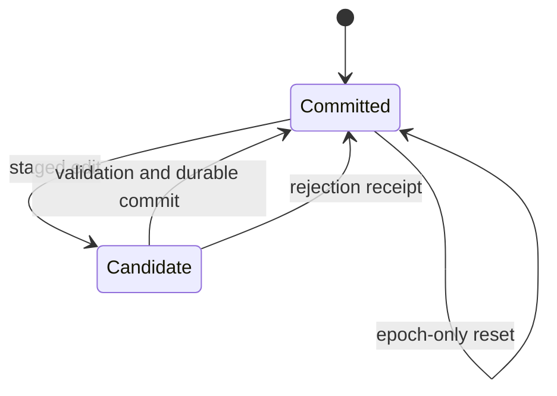

# Durable controller and store

`ContextEditingController.prepare` accepts durable source IDs and produces a frozen
request view. Proposals use session identity, base revision and digest. All user inputs
are pinned. Native tool groups are retained whole or summarized whole; newly appended
live messages cannot be edited. Non-text native metadata is not freely editable.

Never advance the source frontier while dropping new effective messages on budget failure.
Never acknowledge a committed edit before durable persistence. Hard reset must not consume
a pending proposal. Reopen verifies source and committed state; ambiguity fails closed.

The sole authoritative pointer is `manifest.json`, referencing an immutable fsynced
`generations/*.json` snapshot. Legacy `state.json` is ignored. Source tails are verified
against the supplied Prime journal, not truncated. Exclusive ownership uses a random
lock token; closed or poisoned objects cannot write. `protocol.md` is static discovery
material, exposed by `status.protocolPath`. Proposal IDs distinguish retries from new
intended operations, including identical zero-edit resets. A staged file is not a
committed receipt. Validation rejection and ambiguous storage failure are different:
storage failure must poison and throw, never claim an ordinary rejected edit.

Related: [[features/context-editing|feature]],
[[interfaces/context-request-boundary|request boundary]],
[[decisions/preserve-source-and-isolate-epochs|source/epoch decision]].
