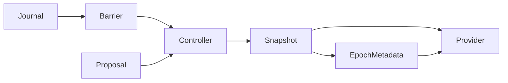

# Context editing

Opt-in single-root mode; original journal is source, immutable committed revisions are
model-visible views, cache epoch identifies isolated serving lineage. The feature-off
path must not create context files or alter existing hooks/compaction/auxiliary behavior.

- [[interfaces/context-request-boundary|Boundary contract]]: await journal persistence,
  validate, pin a request snapshot, and enforce final provider metadata outside optional hooks.
- [[components/context-editing/controller-store|Controller/store]] owns validation, budget,
  durable views and cold reopen.
- [[decisions/preserve-source-and-isolate-epochs|Decision]] rejects rewriting the transcript
  and treating warm approximate cache states as exact.

User guide: `packages/coding-agent/docs/context-editing.md`.
Local proof uses `scripts/clm/ollama-demo.ts`; GPU performance is unvalidated until a real
supported endpoint is exercised. Fake-server tests prove client behavior, not SCR execution.
